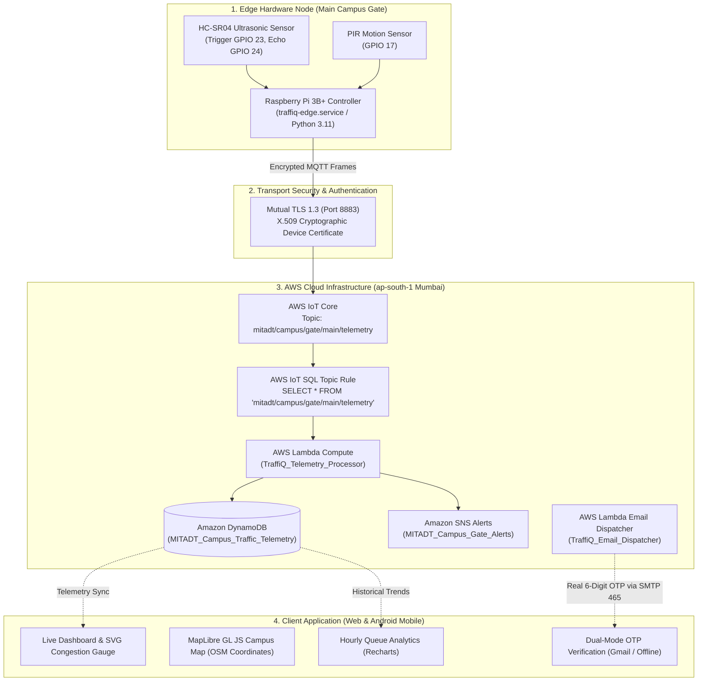

# TraffiQ — MIT-ADT Campus Smart Traffic & Gate Monitoring System

> **An event-driven IoT and serverless cloud monitoring platform engineered for real-time traffic flow estimation, queue analytics, and gate ingress/egress management at MIT Art, Design and Technology University, Rajbaug Campus, Loni Kalbhor, Pune.**

[](https://reactjs.org/)
[](https://www.typescriptlang.org/)
[](https://vitejs.dev/)
[](https://capacitorjs.com/)
[](https://aws.amazon.com/iot-core/)
[](https://aws.amazon.com/lambda/)
[](https://aws.amazon.com/dynamodb/)
[](https://www.terraform.io/)
[](TRAFFIQ_SOURCE_CODE_COPYRIGHT.md)

---

## 1. Project Overview & Institutional Context

**TraffiQ** is an academic IoT prototype and smart campus transit platform developed for **MIT-ADT University (Rajbaug Campus, Loni Kalbhor, Pune – 412201, Maharashtra, India)**.

The system monitors vehicle queuing and transit congestion on the primary approach road connecting the university **Main Campus Gate** to the **Pune-Solapur National Highway (NH 65)**.

### Target Deployment Scope:
* **Monitored Bottleneck**: **Main Campus Gate Checkpoint**.
* **Truthful Physical Telemetry**: Uses physical hardware sensors (**HC-SR04 Ultrasonic Distance Sensor** and **PIR Motion Sensor**) attached to an edge controller (**Raspberry Pi 3B+**) rather than simulated synthetic counters or intrusive camera vision.
* **Dual Uplink**: Edge device publishes encrypted telemetry over **MQTT via mutual TLS (Port 8883)** to AWS IoT Core every 2 seconds, while maintaining an isolated local HTTP diagnostic API (`http://192.168.1.14:8000/telemetry`).

---

## 2. End-to-End System Architecture



---

## 3. Dual-Mode Authentication & Gmail OTP Service

To ensure zero downtime during evaluations, research paper demonstrations, and academic vivas:

1. **Real Cloud Mode (AWS Lambda + Gmail SMTP)**:
   - Serverless function `TraffiQ_Email_Dispatcher` deployed on AWS `ap-south-1`.
   - Uses Python's built-in `smtplib` and `ssl` connected to `smtp.gmail.com:465`.
   - Dispatches branded institutional HTML emails containing the 6-digit verification code to the user's Gmail or university address within 2 seconds.
2. **Academic Viva Fail-Safe Mode**:
   - A hard 4.0-second `AbortController` timeout prevents any network hang or spinner freeze.
   - If offline or on restrictive institutional Wi-Fi, the app automatically exposes a collapsible **"Examiner / Viva Quick View"** backup OTP so presentations never stall.

---

## 4. MIT-ADT Brand Identity & Visual Design

The UI implements a strict **4px spacing grid**, zero AI slop, calm typography, and the official university palette:

* **University Royal Purple**: `#4B168C` (Brand buttons, active tabs, header bar)
* **Institutional Gold**: `#D6A52A` (TraffiQ logo `Q`, barrier accents, status indicators)
* **Background Canvas**: `#F8FAFC` / `#FFFFFF` (Clean, high-legibility cards)
* **Traffic Severity Spectrum**:
  * **Low Traffic**: `#16A34A` (Clear passage, free flow to NH 65)
  * **Moderate Traffic**: `#EA580C` (Steady barrier clearance, 3–5 min queue)
  * **Heavy Traffic**: `#DC2626` (Queuing before checkpoint, 8–12 min delay)
  * **Sensor Offline**: `#64748B` (Hardware failsafe mode)

---

## 5. Repository Structure

```
Traffic project/
├── android/                   # Capacitor Android Studio Project (Gradle, Manifest, Java)
│   ├── app/src/main/
│   │   ├── AndroidManifest.xml
│   │   └── res/               # Custom TraffiQ launcher icons & launch splash screens
│   ├── certs/                 # X.509 Device Certificates for AWS IoT Core mTLS (local only)
├── public/                    # Static campus assets & University imagery
├── scripts/
│   └── generate_app_icons.py  # Pure-Python RGBA PNG icon & splash screen generator
├── src/
│   ├── app/
│   │   ├── App.tsx            # Main root application shell & splash orchestrator
│   │   ├── components/
│   │   │   ├── BottomNavBar.tsx
│   │   │   └── screens/
│   │   │       ├── DashboardScreen.tsx
│   │   │       ├── LiveMapScreen.tsx
│   │   │       ├── AnalyticsScreen.tsx
│   │   │       ├── AlertsScreen.tsx
│   │   │       ├── ProfileScreen.tsx
│   │   │       ├── LoginScreen.tsx
│   │   │       ├── SignUpScreen.tsx
│   │   │       ├── ForgotPasswordScreen.tsx
│   │   │       └── SplashScreen.tsx
│   │   └── services/
│   │       ├── authService.ts # Local user database, sessions & password reset
│   │       └── emailService.ts# AWS Lambda Function URL client with 4s timeout
│   ├── cloud/
│   │   ├── lambda_telemetry_processor.py  # IoT packet ingestion & DynamoDB writer
│   │   └── lambda_email_dispatcher.py      # Gmail SMTP OTP verification microservice
│   └── edge/
│       └── gate_sensor_node.py # Raspberry Pi daemon (HC-SR04, PIR, Paho MQTT 2.x)
├── terraform/                 # Infrastructure as Code (20 AWS Resources)
│   ├── provider.tf            # AWS ap-south-1 provider definition
│   ├── iot.tf                 # AWS IoT Thing, Policy, Rule & X.509 Cert attachments
│   ├── lambda.tf              # Telemetry processor Lambda & IAM execution roles
│   ├── lambda_email.tf        # Email dispatcher Lambda & public Function URL
│   ├── dynamodb.tf            # MITADT_Campus_Traffic_Telemetry table
│   ├── sns.tf                 # MITADT_Campus_Gate_Alerts topic
│   ├── outputs.tf             # IoT endpoint, Function URL & ARNs
│   └── terraform.tfvars.example # Safe variable configuration template
├── capacitor.config.ts        # Capacitor mobile packaging configuration
├── package.json               # Node.js dependencies & scripts
├── tsconfig.json              # TypeScript 5+ compiler configuration
└── vite.config.ts             # Vite bundler configuration
```

---

## 6. Quick Start & Execution Guide

### Prerequisites
* **Node.js**: `v18+` & `pnpm` (or `npm`)
* **Python**: `3.11+`
* **Terraform**: `1.5+` (for AWS cloud provisioning)
* **Android Studio**: Android SDK 34+ with Java 17/21 (for building `.apk`)

---

### Step 1: Web Application Setup
```bash
# 1. Install dependencies
pnpm install

# 2. Run local development server
pnpm dev

# 3. Type-check with zero errors
npx tsc --noEmit

# 4. Build production web bundle
pnpm build
```

---

### Step 2: Android APK Build & Installation
```bash
# 1. Sync web assets into Android project
npx cap sync android

# 2. Build debug APK using Gradle
cd android && ./gradlew assembleDebug

# Output APK location:
# android/app/build/outputs/apk/debug/app-debug.apk

# 3. Install onto attached Android phone via ADB:
adb install -r android/app/build/outputs/apk/debug/app-debug.apk
```

---

### Step 3: Edge Hardware Node Setup (Raspberry Pi 3B+)
```bash
# 1. SSH into Raspberry Pi
ssh nikunj@192.168.1.14

# 2. Place device certificates in ~/traffiq_edge/certs/
# - certificate.pem.crt
# - private.pem.key
# - AmazonRootCA1.pem

# 3. Verify hardware daemon status
sudo systemctl status traffiq-edge.service
```

---

### Step 4: AWS Cloud Infrastructure (Terraform)
```bash
cd terraform
terraform init
terraform plan
terraform apply -auto-approve
```

---

## 7. Statutory Copyright Registration & Authorship

This software is registered under **Form XIV of the Indian Copyright Act, 1957 (Computer Software / Literary Work under Section 2(o))**.

### Joint Authors & Project Team:
* **Rajani Sangappa Sajjan**
* **Nikunj Santosh Hogade**
* **Adwait Pravin Kharade**
* **Shriraj Omkar Salunke**
* **Arayan Atul Londhe**

**Affiliation**: Department of Computer Science & Engineering, MIT Art, Design and Technology University, Pune, Maharashtra, India.  
**Complete Legal Dossier**: Refer to [`TRAFFIQ_SOURCE_CODE_COPYRIGHT.md`](TRAFFIQ_SOURCE_CODE_COPYRIGHT.md).

---

## 8. License & Attributions
* Copyright © 2026 Rajani Sangappa Sajjan, Nikunj Santosh Hogade, Adwait Pravin Kharade, Shriraj Omkar Salunke, and Arayan Atul Londhe. All rights reserved.
* Third-party UI components derived from [shadcn/ui](https://ui.shadcn.com/) under the MIT License.
* Map data © [OpenStreetMap](https://www.openstreetmap.org/copyright) contributors, rendered via [MapLibre GL JS](https://maplibre.org/).
