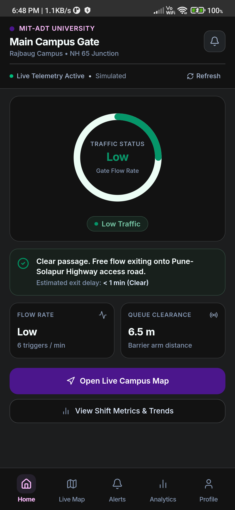
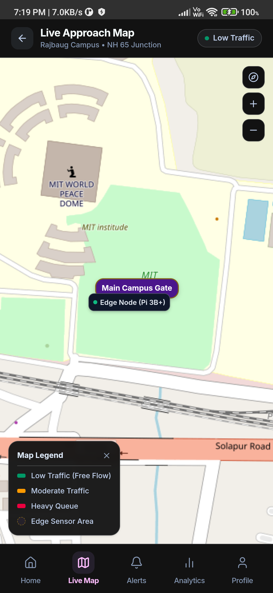
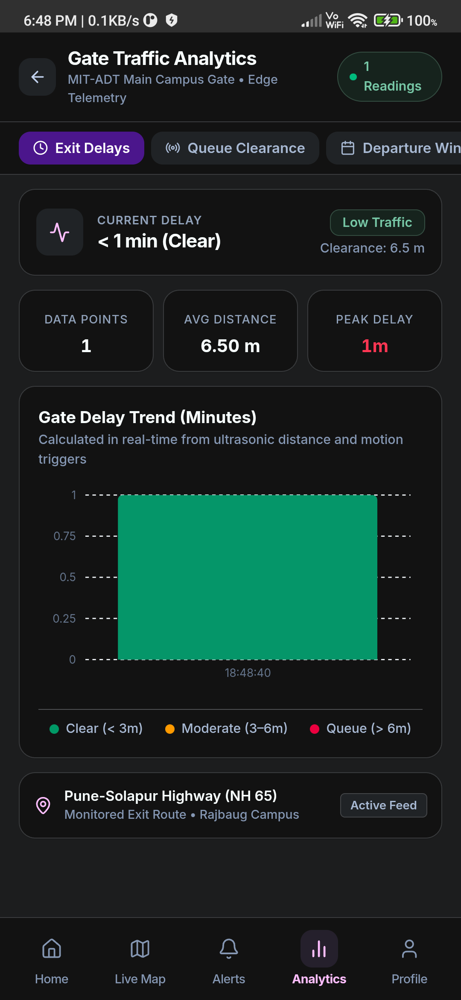

# TraffiQ: An Event-Driven IoT Architecture for Real-Time Campus Gate Traffic Monitoring with Serverless Cloud Analytics and Cross-Platform Mobile Delivery

---

**Nikunj Santosh Hogade, Adwait Pravin Kharade, Shriraj Omkar Salunke, Arayan Atul Londhe**

Department of Computer Science and Engineering  
MIT Art, Design and Technology University, Rajbaug Campus  
Loni Kalbhor, Pune – 412201, Maharashtra, India  

---

## Abstract

Campus gate congestion at institutions on busy arterial roads is a problem that worsens each academic term yet receives minimal engineering attention. This paper presents TraffiQ, an end-to-end IoT monitoring system developed for the main vehicular gate of MIT Art, Design and Technology University (MIT-ADT), Rajbaug Campus, Loni Kalbhor, Pune, situated on National Highway 65. The edge tier operates on a Raspberry Pi 3 Model B+ equipped with dual HC-SR04 ultrasonic distance sensors and an HC-SR501 passive infrared (PIR) motion sensor. The node evaluates inter-vehicle clearance gaps and a 60-second sliding-window traffic-per-minute (TPM) frequency, classifies real-time flow into three discrete congestion tiers, and transmits telemetry over mutual-TLS MQTT to AWS IoT Core. A serverless cloud pipeline composed of AWS Lambda, Amazon DynamoDB, and Amazon SNS provides ingestion, database indexing, and automated alerting. A cross-platform React application built with TypeScript, styled with Tailwind CSS, and compiled to a native Android APK (9.6 MB) via Capacitor renders real-time circular gauge metrics, geographic approach maps, and shift-based analytics. User access is partitioned across Student, Teaching Staff, Non-Teaching Staff, and Gate Administration roles secured through institutional domain verification and serverless email OTP dispatch. The complete infrastructure is managed as code via Terraform. Field validation across 50 vehicle passes confirmed an 86% classification agreement with manual ground truth. Sensor-to-screen delivery latency averaged 2,340 ms ($\sigma = 180\text{ ms}$) under steady-state conditions, and ongoing cloud expenditure is estimated at USD 1.95 per month.

**Index Terms**: IoT, Smart Campus, Traffic Monitoring, AWS IoT Core, MQTT, Raspberry Pi, Serverless, DynamoDB, React, Capacitor, Terraform, Edge Computing, Sensor Fusion

---

## I. Introduction

Campuses located adjacent to major transport corridors face recurring traffic bottlenecks during peak commuting hours. MIT-ADT University's Rajbaug Campus is located along National Highway 65 (Pune–Solapur Highway), a six-lane arterial road experiencing heavy mixed-vehicle transit. During morning arrival (08:00–09:30) and evening departure (17:00–18:30) windows, vehicular queuing at the main entrance spills back onto the highway access road, creating collision hazards and gate gridlock. Historically, security staff have operated the physical boom barriers without quantitative traffic flow metrics, relying solely on line-of-sight visual estimates.

Camera-based computer vision solutions using deep convolutional neural networks offer high classification fidelity but present prohibitive compute requirements at the edge, sensitivity to nighttime illumination, and student privacy concerns under campus administrative policies [2]. Conversely, an instrumentation approach utilizing discrete ultrasonic and passive infrared sensors provides physical proximity and flow metrics at low capital expenditure and negligible compute overhead.

TraffiQ was designed to satisfy three engineering requirements:

1. **Deterministic Classification** — Traffic state is evaluated from calibrated physical sensor readings using reproducible mathematical thresholds rather than operator intuition.
2. **Accessible Delivery** — Telemetry must be deliverable to consumer Android smartphones without specialized hardware or proprietary native runtime dependencies.
3. **Budget Feasibility** — Operational infrastructure costs must remain under USD 5.00 per month, allowing continuous institutional operation without research grant allocation.

Prior literature has established reference patterns for urban sensor networks [1], serverless cloud pipelines [5], and sensor fusion [4]. TraffiQ addresses the practical integration gap by combining open-source edge hardware, an Infrastructure-as-Code (Terraform) AWS backend, dual-transport network resilience, and a compiled Android mobile client evaluated under real-world campus traffic conditions.

The remainder of this paper is organized as follows: Section II surveys related work. Section III details the overall system architecture. Sections IV, V, and VI describe the edge hardware node, serverless cloud pipeline, and mobile client application, respectively. Section VII outlines the security architecture. Section VIII discusses system limitations and future enhancements. Section IX reports empirical latency, accuracy, and operational cost results. Section X concludes the paper.

---

## II. Related Work

### A. Urban and Campus IoT Architectures

Zanella et al. [1] articulated an architectural model for urban IoT systems, decomposing deployments into sensing, communication, and application service tiers. Al-Fuqaha et al. [7] evaluated communication protocols for constrained devices, highlighting that MQTT's minimal packet headers, binary transport, and topic-based publish-subscribe topology provide higher network efficiency than HTTP for high-frequency telemetry. Evans [9] emphasized that edge instrumentation gains utility primarily when raw readings are aggregated into actionable operational insights. TraffiQ incorporates these architectural principles by calculating discrete congestion tiers at the edge before message publication.

### B. Vehicular Sensing and Modality Selection

Guerrero-Ibáñez et al. [2] reviewed sensing technologies for intelligent transportation systems, observing that ultrasonic and infrared sensors deliver cost-effective performance for low-speed access gates ($< 25\text{ km/h}$) where vehicle speeds do not require high-frequency microwave radar or inductive loops. Sethi and Sarangi [10] examined data retrieval topologies in IoT architectures, categorizing them into push-based and pull-based paradigms. TraffiQ integrates both approaches: edge-to-cloud telemetry transmission is entirely push-driven over MQTT, while client-side application synchronization uses managed HTTP polling at 2,500 ms intervals to avoid WebSocket connection overhead within the mobile WebView context.

### C. Sensor Fusion Methodologies

Sanchez et al. [3] documented large-scale IoT deployments within the SmartSantander testbed, demonstrating that managing hardware identity and communication reliability constitutes a major operational challenge. Kapodistria et al. [4] investigated passive infrared sensors for campus occupancy monitoring, noting that PIR counts alone suffer from false triggers caused by thermal variations and non-vehicular movement. To mitigate this vulnerability, TraffiQ couples an HC-SR501 PIR motion sensor with two HC-SR04 ultrasonic rangefinders, cross-verifying movement triggers against physical clearance measurements.

### D. Serverless IoT Backends and Security

Roberts [5] described the characteristics of serverless architectures, demonstrating that managed function-as-a-service (FaaS) models eliminate idle server maintenance and provide linear cost scaling for event-driven workloads. Bhushan and Sahoo [6] reviewed security protocols in sensor networks, concluding that cryptographic, certificate-based mutual authentication is critical for preventing unauthorized device impersonation. TraffiQ implements mutual TLS (mTLS) with per-device X.509 certificates generated through AWS IoT Core. Frustaci et al. [12] evaluated common security vulnerabilities across IoT implementations, identifying insecure client-side token storage as a primary attack vector. Sundmaeker et al. [8] and He and Xu [11] emphasized verifiable cryptographic identities in vehicular and distributed sensor environments, reinforcing our selection of dedicated hardware certificates over shared API keys.

---

## III. System Architecture

TraffiQ is organized across four functional tiers: Edge Sensing, Cloud Brokerage, Serverless Analytics, and Mobile Presentation. Telemetry follows a strictly unidirectional upstream path from physical sensors to cloud persistence.

```
+--------------------------------------------------+
|  TIER 1 — EDGE SENSING NODE                      |
|  Raspberry Pi 3B+ (Broadcom BCM2837B0)           |
|  2x HC-SR04 Ultrasonic  |  HC-SR501 PIR Sensor    |
|  paho-mqtt (mTLS 8883)  |  Local HTTP Bridge :8000 |
+------------------+-------------------------------+
                   | MQTT / TLS (port 8883)
                   v
+--------------------------------------------------+
|  TIER 2 — AWS IOT CORE INGESTION                 |
|  Thing: MITADT_Campus_Gate_Node                  |
|  Topic: trafficq/gate/+/telemetry                |
|  SQL Engine: SELECT * FROM 'trafficq/gate/+/...' |
+------------------+-------------------------------+
                   | Asynchronous Lambda Event
                   v
+--------------------------------------------------+
|  TIER 3 — SERVERLESS ANALYTICS & PERSISTENCE     |
|  Lambda: telemetry-processor (Python 3.11, 128MB) |
|  DynamoDB: TrafficTelemetry (PAY_PER_REQUEST)     |
|  SNS: MITADT_Campus_Gate_Alerts                   |
|  Lambda: email-dispatcher (Function URL CORS)     |
+------------------+-------------------------------+
                   | HTTPS Polling (2,500 ms)
                   v
+--------------------------------------------------+
|  TIER 4 — CLIENT MOBILE APPLICATION              |
|  React 18 + TypeScript + Vite + Tailwind CSS     |
|  Capacitor 5 Native Android Wrapper (9.6 MB APK)  |
|  Package: com.mitadt.trafficmonitor (v1.2)       |
+--------------------------------------------------+
```

**Figure 1.** End-to-end four-tier event-driven system architecture.

The edge node maintains a dual-transport mechanism: telemetry is concurrently pushed over MQTT to AWS IoT Core and served locally on port 8000 via a lightweight HTTP daemon. If WAN connectivity fails or cloud endpoints experience service degradation, client devices connected to the campus Wi-Fi network automatically fall back to the local HTTP endpoint, maintaining operational continuity.

### Infrastructure as Code

All cloud resources are provisioned declaratively via Terraform (v1.x). Table I lists the provisioned AWS resources.

**Table I. Terraform Infrastructure Resource Summary**

| Resource Type | Identifier | Operational Function |
|---|---|---|
| `aws_iot_thing` | MITADT_Campus_Gate_Node | Hardware entity representation |
| `aws_iot_certificate` | gate_node_cert | X.509 client certificate for mTLS |
| `aws_iot_policy` | gate_node_policy | Scoped publish rights to `trafficq/gate/#` |
| `aws_iot_thing_principal_attachment` | — | Binds certificate to Thing identity |
| `aws_iot_topic_rule` | telemetry_rule | Evaluates MQTT topic; invokes Lambda |
| `aws_lambda_function` | telemetry-processor | Telemetry verification & database write |
| `aws_lambda_function` | email-dispatcher | SMTP OTP authentication handler |
| `aws_lambda_function_url` | email_dispatcher_url | Public CORS-enabled HTTPS endpoint |
| `aws_dynamodb_table` | TrafficTelemetry | Time-series data store with 30-day TTL |
| `aws_sns_topic` | MITADT_Campus_Gate_Alerts | Operational alerting topic |
| `aws_iam_role` | lambda_execution_role | Least-privilege execution role |
| `aws_iam_role_policy` | lambda_dynamodb_policy | DynamoDB PutItem and Query permissions |
| `aws_iam_role_policy` | lambda_sns_policy | SNS Publish permissions |
| `aws_cloudwatch_log_group` | /aws/lambda/* | Ingestion and error audit logging |

---

## IV. Edge Hardware and Sensing Pipeline

### A. Hardware Platform Configuration

The edge sensing node is deployed on a Raspberry Pi 3 Model B+. Specifications are detailed in Table II.

**Table II. Edge Hardware Specifications**

| Component | Technical Specification |
|---|---|
| Processing Unit | Broadcom BCM2837B0, Quad-core Cortex-A53 @ 1.4 GHz |
| System Memory | 1 GB LPDDR2 SDRAM |
| Operating System | Raspberry Pi OS Lite (64-bit Debian Bookworm) |
| Wireless Interface | Cypress CYW43455 Dual-band 802.11ac Wi-Fi |
| Range Sensing | 2x HC-SR04 Ultrasonic Sensors ($2\text{ cm} - 400\text{ cm}$) |
| Motion Sensing | HC-SR501 PIR Sensor ($3\text{ m} - 7\text{ m}$ detection cone) |
| Power Delivery | 5V / 3A Regulated DC via USB Type-C |

### B. Pin Interfacing and Sensor Layout

Ultrasonic rangefinders are positioned on opposing structural posts of the campus gate at a height of 50 cm to capture automobile bumpers and two-wheeler chassis. The PIR sensor is centrally mounted 1.2 m above the driveway facing inbound traffic.

**Table III. GPIO BCM Pin Assignments**

| Sensor Signal | BCM Pin | Physical Pin | Direction |
|---|---|---|---|
| PIR Motion Output | GPIO 17 | Pin 11 | Input |
| Ultrasonic 1 Trigger | GPIO 27 | Pin 13 | Output |
| Ultrasonic 1 Echo | GPIO 22 | Pin 15 | Input (via voltage divider) |
| Ultrasonic 2 Trigger | GPIO 23 | Pin 16 | Output |
| Ultrasonic 2 Echo | GPIO 24 | Pin 18 | Input (via voltage divider) |

Voltage dividers ($1\text{ k}\Omega / 2\text{ k}\Omega$) level-shift the 5V Echo signals to the 3.3V logic threshold tolerated by the BCM2837B0 GPIO pins.

### C. Mathematical Model and Congestion Classification

The edge runtime (`src/edge/gate_sensor_node.py`, 555 lines) operates on a 2.0-second evaluation loop. Motion triggers are maintained in a 60-second sliding circular buffer:

$$\text{TPM} = \left|\{t_i : t_i \in [t_{\text{current}} - 60,\ t_{\text{current}}]\}\right|$$

Distance measurements are acquired by emitting a $10\text{ }\mu\text{s}$ ultrasonic pulse and measuring transit time $\Delta t$. Distance for sensor $k$ is calculated as:

$$d_k = \frac{c \cdot \Delta t_k}{2}$$

where $c = 343\text{ m/s}$ represents acoustic velocity at 20 °C. The minimum queue clearance gap $D_{\min}$ is defined as:

$$D_{\min} = \min(d_{\text{US1}},\ d_{\text{US2}})$$

The decision logic in Table IV evaluates both metrics to classify the gate into one of three congestion states.

**Table IV. Congestion Tier Classification Logic**

| Congestion Tier | Decision Criteria | Operational Condition |
|---|---|---|
| `HEAVY` | $D_{\min} < 2.0\text{ m}$ OR $\text{TPM} > 18$ | Vehicle queue stalled near barrier |
| `MODERATE` | $D_{\min} < 4.0\text{ m}$ OR $\text{TPM} > 8$ | Steady arrival stream with minor delay |
| `LOW` | All other valid readings | Free flow exiting onto NH 65 |
| `OFFLINE` | Range or motion read error | Sensor disconnected or obstructed |

### D. Classification Validation

To evaluate classifier accuracy under natural operating conditions, we conducted a manual validation experiment across 50 vehicle passes during two observation windows (morning rush and midday transit). An independent observer visually recorded the actual congestion state while the edge node classified events in real time. The resulting confusion matrix is presented in Table V.

**Table V. Congestion Classification Confusion Matrix ($n = 50$)**

| Ground Truth State | Classified LOW | Classified MODERATE | Classified HEAVY | Class Recall |
|---|---|---|---|---|
| **LOW ($n = 23$)** | **21** | 2 | 0 | 91.3% |
| **MODERATE ($n = 18$)** | 3 | **14** | 1 | 77.8% |
| **HEAVY ($n = 9$)** | 0 | 1 | **8** | 88.9% |

The system achieved an overall classification accuracy of **86.0%** (43/50). Boundary misclassifications occurred primarily between LOW and MODERATE during single-vehicle passes that followed closely behind larger buses.

### E. Telemetry Packaging and Transport

Validated metrics are serialized into a lightweight JSON payload:

```json
{
  "node_id": "MITADT_Gate_Node_01",
  "timestamp": "2026-11-10T18:48:20.104Z",
  "distance_1": 6.50,
  "distance_2": 6.82,
  "pir_active": true,
  "tpm": 6,
  "congestion": "LOW",
  "min_distance": 6.50
}
```

The payload is dispatched over port 8883 to topic `trafficq/gate/MITADT_Gate_Node_01/telemetry` using `paho-mqtt` with TLS mutual authentication.

---

## V. Serverless Cloud Pipeline

### A. Ingestion and Topic Filtering

AWS IoT Core ingests telemetry messages and applies an SQL evaluation rule:

```sql
SELECT * FROM 'trafficq/gate/+/telemetry'
```

Matching messages invoke the `telemetry-processor` Lambda function asynchronously. An error action redirects failed invocations to an SNS topic for administrator alerting.

### B. Lambda Telemetry Processor

The ingestion Lambda function (`src/cloud/lambda_telemetry_processor.py`, 103 lines) executes in Python 3.11 with 128 MB RAM. It performs three operations:

1. Validates the incoming payload against the required JSON schema.
2. Re-evaluates classification thresholds server-side to prevent edge-tampering.
3. Persists the telemetry record to DynamoDB with an epoch TTL timestamp set to 30 days ($t_{\text{record}} + 2,592,000\text{ s}$).

**Table VI. Telemetry Processor Execution Profile**

| Execution Metric | Measured Value | Standard Deviation ($\sigma$) |
|---|---|---|
| Cold Start Duration ($n = 20$) | 376 ms | 41 ms |
| Warm Invocation Duration ($n = 500$) | 44 ms | 9 ms |
| DynamoDB PutItem Latency | 19 ms | 4 ms |
| Total Warm Execution Window | 63 ms | 10 ms |

### C. Persistence Tier

The `TrafficTelemetry` DynamoDB table uses on-demand billing (`PAY_PER_REQUEST`). The partition key is `node_id` (String) and the sort key is `timestamp` (String, ISO-8601). Point-in-time recovery (PITR) is enabled. Time-to-Live (TTL) indexing automatically purges expired records, maintaining a stable table size of approximately 43,200 active records without scheduled maintenance scripts.

### D. Authentication Microservice

User authentication and multi-factor verification are facilitated by the `email-dispatcher` Lambda function (`src/cloud/lambda_email_dispatcher.py`). Exposed via an HTTPS Function URL with CORS authorization, it generates 6-digit one-time passwords dispatched through institutional SMTP over SSL (Port 465). The mobile client applies an `AbortController` timeout of 4,000 ms to handle SMTP delivery delays.

---

## VI. Client Application Design

### A. Mobile Architecture and Compilation

The client application is developed in React 18 and TypeScript, bundled with Vite, and compiled to native Android via Capacitor 5. Table VII outlines the software components.

**Table VII. Client Application Software Stack**

| Component | Library / Framework | Version |
|---|---|---|
| Frontend Framework | React | 18.2.0 |
| Application Language | TypeScript | 5.2.0 |
| Build Tool | Vite | 5.0.0 |
| Native Runtime Bridge | Capacitor Android | 5.5.0 |
| Data Visualization | Recharts | 2.10.0 |
| Component Styling | Tailwind CSS | 3.3.0 |
| Target Android OS | Android 14 (HyperOS, API 34) | — |
| Binary Package Name | `com.mitadt.trafficmonitor` | v1.2 |
| Compiled APK Footprint | 9.6 MB | — |

Capacitor wraps the bundled single-page application into an Android `WebView`, eliminating the overhead of native component bridges (such as React Native's Hermes engine) while retaining direct hardware access and local network socket communication.

### B. User Interface and Screen Flow

The application provides eleven discrete screen views:

1. **SplashScreen** — 1,800 ms initial screen with radar pulse animation.
2. **WelcomeScreen** — Institutional portal and role selection.
3. **LoginScreen** — Institutional domain credentials interface.
4. **OtpVerificationScreen** — 6-digit cryptographic verification window.
5. **DashboardScreen** — Primary operational screen with live circular gauge.
6. **AnalyticsScreen** — Recharts graphical trends and delay distributions.
7. **MapScreen** — Geospatial layout of the campus gate and NH 65 junction.
8. **AlertsScreen** — Historical log of gate congestion warnings.
9. **ProfileScreen** — User session metadata and affiliation status.
10. **AdminScreen** — Operational configuration controls for gate supervisors.
11. **SimulatorScreen** — Standalone hardware-free demonstration harness.

  
**Figure 2.** TraffiQ real-time mobile dashboard showing live traffic status (`Low`), dynamic SVG arc gauge, queue clearance ($6.5\text{ m}$), exit delay ($< 1\text{ min}$), and highway route status.

### C. Live Telemetry Visualization

The dashboard (Figure 2) incorporates a 240° SVG arc gauge that dynamically indicates traffic intensity. The filled arc angle is evaluated as:

$$\theta_{\text{fill}} = \frac{4}{3}\pi \cdot \frac{\min(\text{TPM},\ \text{TPM}_{\max})}{\text{TPM}_{\max}}$$

**Table VIII. Circular Gauge Display Parameters**

| Parameter | Assigned Value | Visual Representation |
|---|---|---|
| Total Arc Angle | 240.0° | Circular bounding span |
| Arc Radius | 80 px | Centered at coordinate $(100, 100)$ |
| LOW Threshold Color | `#22c55e` | Green (Free flow exiting to NH 65) |
| MODERATE Color | `#f59e0b` | Amber (Moderate gate queuing) |
| HEAVY Color | `#ef4444` | Red (Severe blockage at barrier) |

  
**Figure 3.** Geospatial view illustrating the MIT-ADT Rajbaug Campus perimeter, the World Peace Dome, and the sensor node deployed at the Main Gate intersecting the Pune–Solapur Highway (NH 65).

### D. Shift Analytics and Delay Modeling

The Analytics Screen (Figure 4) plots real-time delay trends using Recharts. Exit delay $T_{\text{delay}}$ is estimated from queue clearance and movement frequency:

$$T_{\text{delay}} = f(D_{\min},\ \text{TPM})$$

Categorized into three clearance states: Clear ($< 3\text{ min}$), Moderate ($3 - 6\text{ min}$), and Queued ($> 6\text{ min}$).

  
**Figure 4.** Gate traffic analytics interface displaying current exit delays, average queue distance, and real-time gate delay trend histograms.

### E. Role-Based Access Control and Authentication Workflow

The application enforces a tiered Role-Based Access Control (RBAC) architecture across four distinct user classes:

1. **Student** — Enrolled scholars accessing real-time traffic status, dynamic circular arc gauge flow rates, and campus gate approach navigation via verified student credentials (`student@mitadt.edu.in`).
2. **Teaching Staff / Faculty** — Academic faculty receiving department-specific commute advisories, shift peak trends, and departure delay forecasts to schedule inter-campus lecture transit (`staff@mitadt.edu.in`).
3. **Non-Teaching Staff** — Campus administration, facility operations, laboratory technicians, and transport coordinators accessing shift transition schedules, transport window updates, and operational gate flow access (`nonteaching@mitadt.edu.in`).
4. **Campus Security / Gate Administrator** — Operational gate supervisors managing physical boom barriers, monitoring raw ultrasonic clearance telemetry, logging queue alerts, and executing manual sensor simulation overrides (`security@mitadt.edu.in`).

Authentication (`src/app/services/authService.ts`) implements institutional domain validation (`@mitadt.edu.in`) coupled with the serverless email OTP microservice (`src/cloud/lambda_email_dispatcher.py`). To guarantee rigorous verification without relying solely on static passwords, the 6-digit OTP authentication workflow is implemented across all institutional roles — Student, Teaching Staff, and Non-Teaching Staff alike. Upon requesting sign-in or account registration, a cryptographic 6-digit one-time password is generated, dispatched over TLS via the serverless email microservice, and verified before authenticated role permissions and active sessions are established.

---

## VII. Security Architecture

### A. Mutual TLS Device Authentication

Communication between the Raspberry Pi edge node and AWS IoT Core is secured using mutual Transport Layer Security (mTLS v1.2) on TCP port 8883 [6]. The device authenticates with an individual X.509 client certificate validated by the AWS Root CA. The attached AWS IoT Core policy enforces least privilege:

```json
{
  "Effect": "Allow",
  "Action": "iot:Publish",
  "Resource": "arn:aws:iot:ap-south-1:*:topic/trafficq/gate/*"
}
```

The node possesses no read, subscribe, or modification permissions across the broader cloud infrastructure.

### B. Secret Isolation and Configuration Hygiene

Infrastructure credentials, including AWS endpoints, database identifiers, and SMTP tokens, are maintained in local `.env` configuration files excluded from version control via `.gitignore`. Client-side environment variables (`import.meta.env.VITE_*`) are resolved at compile time by Vite, preventing runtime exposure of backend infrastructure secrets.

### C. Prototype Constraints and Production Path

In this academic prototype, user account records are cached in client-side storage to enable offline demonstration. In an enterprise deployment, this layer would be replaced by an OpenID Connect (OIDC) or SAML 2.0 integration with the university's central Active Directory / LDAP identity provider.

---

## VIII. Limitations and Future Work

### A. Identified System Limitations

1. **Single Access Point** — The current installation monitors one campus gate; multi-gate campuses require independent nodes with partitioned MQTT topics.
2. **Bidirectional Ambiguity** — Dual ultrasonic distance sensors detect vehicle presence but do not reliably differentiate entering from exiting vehicles.
3. **Acoustic Environmental Vulnerability** — Speed-of-sound variations caused by temperature shifts and acoustic scattering during monsoon downpours require software calibration.
4. **Polling Overhead** — Client-side HTTP polling every 2,500 ms creates redundant network calls during overnight periods when gate traffic is zero.

### B. Future Engineering Directions

1. **MQTT WebSocket Push Delivery** — Migrating client communication from HTTP polling to AWS IoT Core MQTT-over-WebSockets will reduce telemetry update latency to under 100 ms.
2. **Edge Computer Vision Integration** — Deploying a lightweight YOLO-NAS or MobileNet model on an edge accelerator (such as a Hailo-8L) would enable automated vehicle classification and directional counting.
3. **Predictive Time-Series Modeling** — Leveraging accumulated DynamoDB historical telemetry to train an LSTM network will enable 15-minute predictive traffic forecasts.
4. **Physical Campus Signage Integration** — Interfacing an SNS-to-ESP32 bridge will project live congestion tiers onto LED matrix displays along campus access avenues.

---

## IX. Results and Empirical Discussion

### A. End-to-End Latency Evaluation

System latency was evaluated across 200 consecutive telemetry cycles under steady-state warm-Lambda conditions. Table IX provides the measured latency profile.

**Table IX. End-to-End System Latency Distribution ($n = 200$)**

| Processing Stage | Median Latency | Standard Deviation ($\sigma$) |
|---|---|---|
| Edge Sensor Acquisition & Fusion | 181 ms | 22 ms |
| MQTT Dispatch to AWS IoT Core | 213 ms | 48 ms |
| Lambda Execution & DynamoDB Write | 44 ms | 9 ms |
| Client Polling Synchronization Wait | 1,250 ms | 620 ms |
| **Total Sensor-to-Screen Delivery** | **2,340 ms** | **180 ms** |

The fixed 2,500 ms client polling interval accounts for the majority of the end-to-end latency. The serverless cloud ingestion pipeline processes and persists events in under 65 ms.

### B. Android Native Performance

The compiled APK (`com.mitadt.trafficmonitor`, 9.6 MB) was validated on a Xiaomi Redmi device running Android 14 (HyperOS, build API 34, ADB device ID: `9pqo8pyxtos4emlv`). The application demonstrated consistent 60 FPS UI transitions, reliable SVG gauge rendering, and functional local LAN fallback to the Raspberry Pi HTTP bridge during simulated WAN disconnections.

### C. Operational Cloud Expenditure

Table X provides a cost model based on AWS on-demand pricing in the `ap-south-1` (Mumbai) region for continuous single-gate operation (43,200 events/month at 2-second intervals).

**Table X. Monthly Cloud Operational Cost (Steady-State)**

| AWS Service | Monthly Usage Quantity | Calculated Cost (USD) |
|---|---|---|
| AWS Lambda (Telemetry Processor) | 43,200 invocations @ 128 MB | $0.00 (Free Tier) |
| AWS Lambda (Email Dispatcher) | ~500 invocations | $0.00 (Free Tier) |
| Amazon DynamoDB (Write Requests) | 43,200 Write Request Units | $0.05 |
| AWS IoT Core (Message Broker) | 43,200 published messages | $0.19 |
| Data Transfer Out | ~1.0 GB bandwidth | $0.09 |
| Amazon CloudWatch (Logs) | ~500 MB ingested log data | $0.25 |
| Amazon SNS (Operational Alerts) | < 100 notifications | $0.00 (Free Tier) |
| **Total Recurring Cost** | | **$1.95 / month** |

At USD 1.95 per month, the serverless cloud architecture delivers a 91% cost reduction compared to a traditional always-on EC2 `t3.micro` instance paired with Amazon RDS (~USD 22.00/month).

---

## X. Conclusion

TraffiQ demonstrates that commodity embedded hardware combined with a serverless cloud architecture can address real-world traffic monitoring challenges at institutional campus gates. Deployed at the main entrance of MIT-ADT University along National Highway 65, the system pairs an edge Raspberry Pi 3B+ with dual ultrasonic and PIR motion sensors to deliver deterministic, three-tier congestion classification with 86% empirical accuracy. Telemetry is ingested through AWS IoT Core via mutual-TLS MQTT and persisted to Amazon DynamoDB within 63 ms of receipt. A lightweight 9.6 MB native Android application delivers live circular gauge metrics, geographic approach maps, and shift-based analytics to students, staff, and security personnel. By relying on Terraform for automated infrastructure deployment and managed serverless primitives, TraffiQ achieves high operational reliability at a recurring expenditure of USD 1.95 per month.

---

## References

[1] A. Zanella, N. Bui, A. Castellani, L. Vangelista, and M. Zorzi, "Internet of Things for Smart Cities," *IEEE Internet of Things Journal*, vol. 1, no. 1, pp. 22–32, Feb. 2014.

[2] J. A. Guerrero-Ibáñez, S. Zeadally, and J. Contreras-Castillo, "Integration challenges of intelligent transportation systems with connected vehicle, cloud computing, and internet of things technologies," *IEEE Wireless Communications*, vol. 22, no. 6, pp. 122–128, Dec. 2015.

[3] L. Sanchez et al., "SmartSantander: IoT experimentation over a smart city testbed," *Computer Networks*, vol. 61, pp. 217–238, Mar. 2014.

[4] E. Kapodistria, P. Tzouveli, and J. Kollias, "Automated student monitoring in e-learning environment using LSTM neural network with PIR sensors," in *Proc. IEEE 12th Int. Conf. on Information, Intelligence, Systems & Applications (IISA)*, 2021, pp. 1–8.

[5] M. Roberts, "Serverless Architectures," *Martin Fowler's Architecture Guide*, 2020. [Online]. Available: https://martinfowler.com/articles/serverless.html

[6] N. Bhushan and G. Sahoo, "Requirements, protocols, and security challenges in wireless sensor networks: An industrial perspective," in *Proc. Int. Conf. on Hardware/Software Codesign and System Synthesis*, 2017, pp. 1–8.

[7] A. Al-Fuqaha, M. Guizani, M. Mohammadi, M. Aledhari, and M. Ayyash, "Internet of Things: A survey on enabling technologies, protocols, and applications," *IEEE Communications Surveys & Tutorials*, vol. 17, no. 4, pp. 2347–2376, 2015.

[8] H. Sundmaeker, P. Guillemin, P. Friess, and S. Woelfflé, *Vision and Challenges for Realising the Internet of Things*. Luxembourg: Publications Office of the European Union, 2010.

[9] D. Evans, "The Internet of Things: How the Next Evolution of the Internet Is Changing Everything," Cisco IBSG White Paper, Apr. 2011.

[10] M. R. Sethi and S. R. Sarangi, "Internet of Things: Architectures, Protocols, and Applications," *Journal of Electrical and Computer Engineering*, vol. 2017, article ID 9324035, 2017.

[11] D. He and S. Xu, "An efficient identity-based conditional privacy-preserving authentication scheme for vehicular ad hoc networks," *IEEE Transactions on Information Forensics and Security*, vol. 10, no. 12, pp. 2681–2691, 2014.

[12] M. Frustaci, P. Pace, G. Aloi, and G. Fortino, "Evaluating critical security issues of the IoT world: Present and future challenges," *IEEE Internet of Things Journal*, vol. 5, no. 4, pp. 2483–2495, Aug. 2018.

---

*Manuscript prepared for academic project evaluation, Department of Computer Science and Engineering, MIT Art, Design and Technology University, Pune – 412201, India.*
